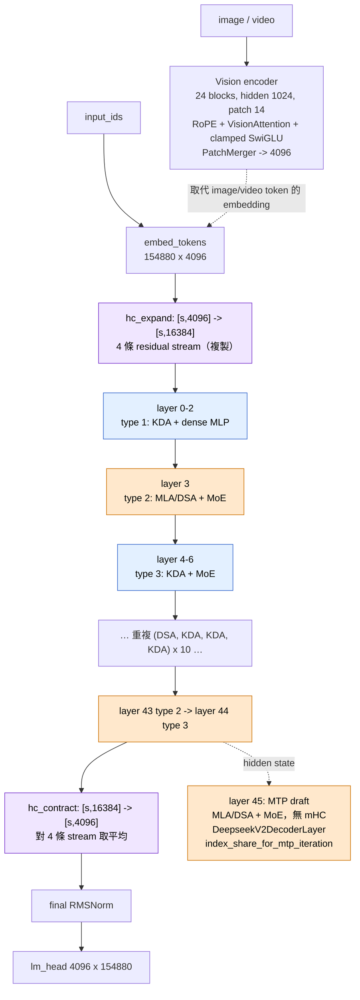
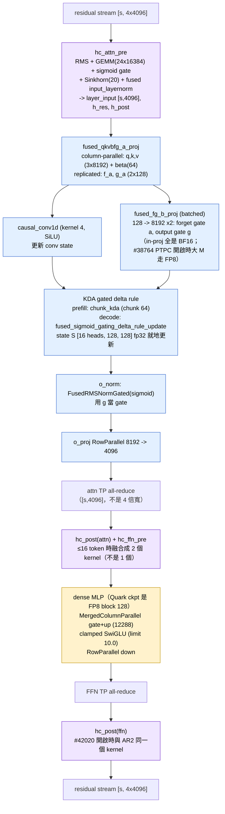
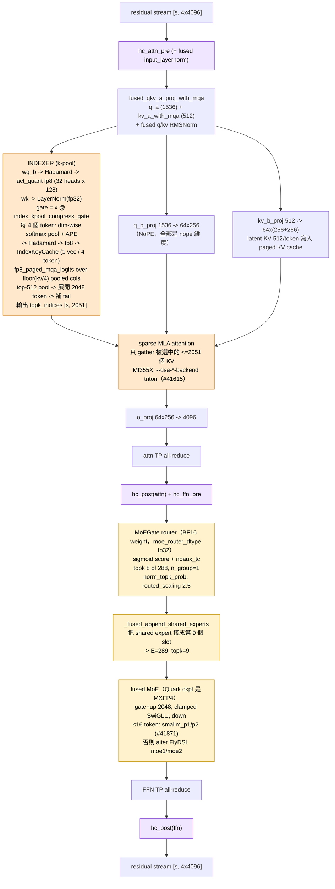
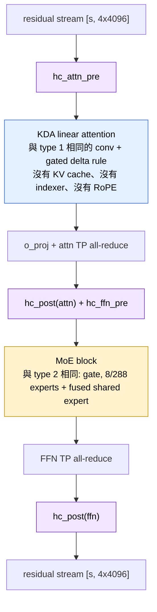

# GLM-5.3-Flash：三種 decoder layer

兩個獨立的 config axis 決定一層跑什麼：

| axis | config | 效果 |
|---|---|---|
| Attention | `layer_types[i]` | `i % 4 != 3` → **KDA** linear attention（34 層）；`i % 4 == 3` → **MLA + DSA** sparse attention（11 層） |
| FFN | `first_k_dense_replace = 3` | layer 0-2 用 dense `Glm5NextMLP`（= `DeepseekV2MLP`, intermediate 12288, clamped SwiGLU）；layer 3-44 用 `Glm5NextMoE`（= `DeepseekV2MoE`, 288 experts） |

因為 layer 3 同時是第一個 DSA layer 也是第一個 MoE layer，「DSA + dense MLP」這個組合
不存在，所以只有三種：

| # | layer type | layers | 數量 |
|---|---|---|---|
| 1 | **KDA + dense MLP** | 0, 1, 2 | 3 |
| 2 | **MLA/DSA + MoE** | 3, 7, 11, …, 43 | 11 |
| 3 | **KDA + MoE** | 4-6, 8-10, …, 44 | 31 |
| — | MTP draft（`nextn`, layer id 45） | 45 | 1，attention / FFN 跟 type 2 一樣，但 **沒有 mHC** |

**45 層 text layer 都套上 mHC**：進 attention 前一次 `hc_pre`、出 attention 後一次
`hc_post`、進 FFN 前一次 `hc_pre`、出 FFN 後一次 `hc_post`。詳見 `mhc.md`。

MTP draft layer 例外：`Glm5NextForConditionalGenerationNextN` 繼承
`DeepseekV3ForCausalLMNextN`，draft layer 是 `DeepseekV2DecoderLayer`（`skip_rope=True`），
單一 residual stream，checkpoint 的 `model.layers.45.*` 沒有 `hc_*` 權重。

## 全模型骨架

## Type 1 — KDA + dense MLP（layer 0, 1, 2）

Layer 0 的特別之處：`hc_expand` 在這裡把 embedding 從 `[s,4096]` 複製成 `[s,16384]`
（4 條 stream 一開始完全相同），而且它前面沒有上一層的 all-reduce。

## Type 2 — MLA/DSA + MoE（layer 3, 7, 11, …, 43）

這是唯一有 KV cache 和 indexer 的層。注意 **沒有任何 RoPE**：`qk_rope_head_dim=0`
且 `skip_rope=True`，所以 `rotary_emb is None`，indexer 也跳過 RoPE。

## Type 3 — KDA + MoE（31 層，最常見）

Attention 路徑跟 type 1 完全一樣、FFN 路徑跟 type 2 完全一樣：

## 用 kernel 反推 layer type

看 trace 時最快的判斷方式：

| 看到的 kernel | 一定是 |
|---|---|
| `causal_conv1d_*`, `chunk_kda`, `fused_sigmoid_gating_delta_rule_update`, `FusedRMSNormGated` | KDA layer（type 1 或 3） |
| `fp8_mqa_logits` / `fp8_paged_mqa_logits`, `kpool_*_write_cache`, `topk_transform`, sparse MLA kernel | DSA layer（type 2） |
| `moe_sorting` / `moe1` / `moe2` / `moe_reduction`, router hgemm | MoE layer（layer >= 3） |
| `mhc_pre` / `mhc_post` / `mhc_fused_post_pre` | 45 層 text layer 都有；MTP draft layer 沒有 |
| 任何 RoPE kernel | **vision encoder**，不會是 text layer |

前 3 層沒有 MoE kernel、且是 KDA → type 1。有 MoE 又有 indexer → type 2。

### MI355X 實際 kernel 名稱（1012 image + PR stack，TP4 decode conc 1）

來源：`prof-Fixed-MXFP4-TP4-1012-prstack/no-cuda-graph/prof_in70000_out64_conc1_p1` 的
TP0 DECODE trace，4 個 decode step，表中是 **每 step 次數**。跑的時候有
`SGLANG_ROCM_FUSED_AR_MHC_POST=1`、`SGLANG_OPT_GLM53_KDA_PTPC_MODULES=...`、`--dsa-*-backend triton`。

| kernel | 次數 / step | 歸屬 |
|---|---|---|
| `fused_sigmoid_gating_delta_rule_update_kernel`、`_causal_conv1d_update_kernel`、`layer_norm_gated_fwd_kernel` | 34 | KDA recurrence、conv、`o_norm` |
| `hgemm_bf16_t16x16x128...`（aiter BF16 hgemm） | 34 | KDA fused in-proj BF16 GEMM（由次數推斷；aiter#5982 調的就是這組 shape） |
| `_sparse_mla_decode_split_kernel` + `_sparse_mla_reduce_kernel` | 11 | DSA sparse MLA（Triton，#41615） |
| `_gluon_deepgemm_fp8_paged_mqa_logits_preshuffle`、`kpool_topk_transform_kernel<512>`、`_kpool_decode_update_and_maybe_write_cache_kernel` | 11 | k-pool indexer |
| `act_quant_kernel`、`fast_hadamard_transform_kernel`、`vectorized_layer_norm_kernel<float>` | 11 | indexer Q 量化、Q Hadamard（只有 Q）、`wk` 後的 fp32 LayerNorm |
| `set_mla_kv_buffer_kernel_norope`、`fused_qk_rmsnorm_kernel` | 11 | MLA latent KV 寫入（NoPE）、q/kv RMSNorm |
| `ck::kernel_gemm_xdl_cshuffle_v3_multi_d_blockscale_b_preshuffle` + `dynamic_per_group_scaled_quant` + `fp8gemm_bf16_blockscale_BpreShuffle` | 36 + 3 | FP8 block GEMM：MLA 3 個 projection × 11 + dense MLP 2 × 3 |
| `_fused_clamp_silu_mul_kernel` | 3 | dense MLP 的 clamped SwiGLU |
| `grouped_topk_kernel`、`_fused_append_shared_experts_kernel` | 42 | router top-k、把 shared expert 接成第 9 個 slot |
| `_gemm_a16_w16_kernel ... BLOCK_SIZE_K_512` | 42 | router GEMM（由次數推斷；N=288, K=4096 正是 aiter#5933 的 config） |
| `smallm_p1_i512_c16` + `smallm_p2_i512_s9` | 42 | MXFP4 MoE small-M kernel（#41871，≤16 token） |
| `mhc_pre_gemm_sqrsum_kernel` | 45 | `hc_attn_pre` 的 mixing GEMM |
| `mhc_fused_post_pre_gemm_sqrsum_kernel` | 45 | attn→FFN boundary：`hc_post(attn)` 融進 `hc_ffn_pre` 的 GEMM |
| `mhc_pre_big_fuse_rmsnorm_kernel` | 90 | 兩次 pre 的 Sinkhorn + gate + RMSNorm（每層 2 次） |
| `allreduce_mhc_post_large_m_kernel` | 45 | FFN all-reduce + `hc_post(ffn)`（#42020） |
| `ar_ll_gfx9` | 46 | attention all-reduce（45）+ 1 |

所以 decode 時每層 mHC 是 **5 個 kernel**（attn pre 2、boundary 2、AR+post 1），沒有獨立的
`mhc_post`。沒有 PR stack 時，boundary 以外的 FFN `hc_post` 是單獨的 `mhc_post`，
all-reduce 也是單獨的。

注意 no-cuda-graph trace 裡 `ar_ll_gfx9` / `allreduce_mhc_post_*` 佔 90% 以上時間，那是 eager
模式下跨 rank 等待，不是 kernel 本身的成本；看比例要用 CUDA graph 的 trace。

## 參數量拆解（驗證 320B / 18B）

hidden = 4096，MoE expert intermediate = 2048，dense intermediate = 12288。

| 部位 | 計算 | 參數量 |
|---|---|---|
| Routed experts | 288 × 3 × 4096 × 2048 × 42 layer | ≈ 304.4 B |
| Shared expert | 1 × 3 × 4096 × 2048 × 42 layer | ≈ 1.06 B |
| Dense MLP | 3 × 4096 × 12288 × 3 layer | ≈ 0.45 B |
| KDA attention | ≈ 136 M × 34 layer | ≈ 4.6 B |
| MLA + indexer | ≈ 125 M × 11 layer | ≈ 1.4 B |
| mHC (`hc_*_fn` = 24 × 16384，一層兩份) | 0.39 M × 2 × 45 | ≈ 35 M |
| embed + lm_head | 2 × 154880 × 4096 | ≈ 1.27 B |
| Vision encoder | ≈ 16.8 M × 24 + merger | ≈ 0.4 B |
| **合計** | | **≈ 313 B**（不含 MTP；MTP layer 約 7.4 B，加起來 ≈ 320 B，HF 標 321.3 B） |

Active per token：8 routed + 1 shared = 9 experts × 25.2 M × 42 = 9.5 B，
加上 dense MLP 0.45 B、所有 attention 6.0 B、embed/head 1.27 B → **≈ 17.3 B ≈ 18B**。

## 與 GLM-5.2 的逐項對照

| 項目 | GLM-5.2 | GLM-5.3-Flash |
|---|---|---|
| 層數 | 78 | 45（+1 MTP） |
| hidden | 7168 | 4096 |
| Attention | 全部 MLA + DSA | **hybrid**：34 KDA + 11 MLA/DSA |
| 有 indexer 的層 | 21 / 78（`index_topk_freq=4`，其餘層共用上一層的 top-k） | 11 / 45（`indexer_types` 全是 `"full"`，每層各自算，無跨層共用） |
| Indexer 粒度 | per-token K，logits 寬 `kv_len` | **k-pool 4**：pooled K，logits 寬 `kv_len/4` |
| top-k 輸出寬度 | 2048 | **2051**（2048 + 最多 3 個 tail token） |
| RoPE | indexer 內有 RoPE（Wq/Wk 後） | **完全沒有**（NoPE，`qk_rope_head_dim=0`） |
| MLA head dim | qk_nope 128 + qk_rope 64, v 128 | qk_nope **256** + qk_rope **0**, v **256** |
| kv_lora_rank | 512 | 512（KV cache = 512/token/layer，因 rope dim = 0） |
| Residual | 單一條 + `add_rmsnorm_quant` | **mHC 4 條 stream** + `hc_pre` / `hc_post` |
| Experts | 256 routed, topk 8, 1 shared | **288** routed, topk 8, 1 shared |
| Expert 量化 | MXFP4（OneNexus 版） | FP8 e4m3 block 128×128（官方 ckpt）；`amd/GLM-5.3-Flash-Quark-MXFP4` 是 MXFP4（layer 3–44），MTP layer 45 的 experts 仍是 FP8 |
| 模態 | text only | text + image + video（24-layer vision encoder） |
| MTP | 無 | 1 層 nextn draft（MLA/DSA + MoE，無 mHC），`index_share_for_mtp_iteration` |
| Dense 層 | 0-2（`first_k_dense_replace=3`） | 0-2（同樣是 3） |
