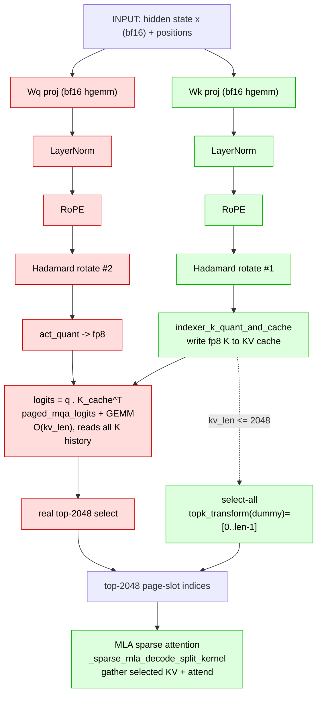

# GLM-5.2 / DSA lightning-indexer decode flow

Per decode token, per DSA layer. The indexer picks the top-`index_topk` (2048)
KV positions for the main MLA sparse attention.

- Input: `hidden state x` (bf16) + `positions`.
- Indexer q/k projections are **bf16** GEMMs (`hgemm_bf16_...`); only the logits
  input is quantized to **fp8** (`act_quant`). NOT FP4 (unlike the MoE experts).
- 🟩 green = always runs · 🟥 red = skipped when `kv_len ≤ index_topk (2048)`
  (the eager k-only fast path, `_forward_cuda_k_only`; PR31324).

## What can / cannot be skipped when kv_len ≤ 2048

| Part | Kernels | kv ≤ 2048 |
|------|---------|-----------|
| Key build + cache | Wk proj, LayerNorm, RoPE, Hadamard #1, `indexer_k_quant_and_cache` | **must run** — K for this token must be cached; later steps (kv>2048) score all history |
| Index list for gather | `topk_transform` | **must run** (cheap select-all `[0..len-1]`; MHA path needs none) |
| Query build | Wq proj, LayerNorm, RoPE, Hadamard #2, `act_quant` | **skipped** |
| Scoring | `paged_mqa_logits` + logits GEMM | **skipped** |
| Selection | real top-k | **skipped** (→ select-all) |

Hadamard count is the tell: **i1k = 1** (K only), **i8k = 2** (Q + K) — assuming
`SGLANG_DSA_FUSE_HADAMARD_QUANT` is off (fused → 0 separate hadamard kernels).
Full-layer indexer ≈ 94 µs; k-only ≈ 31 µs.
