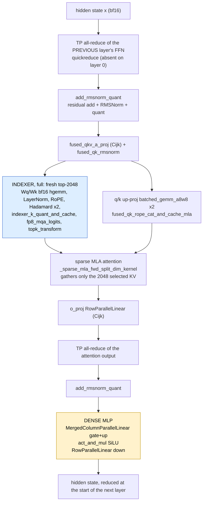
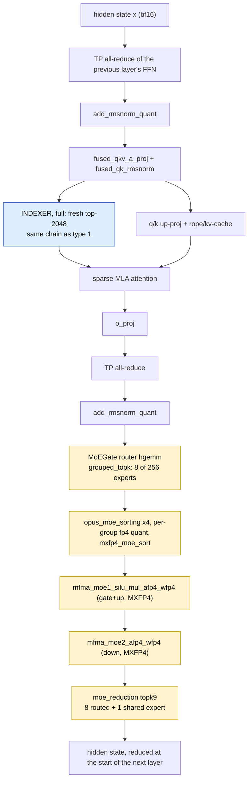
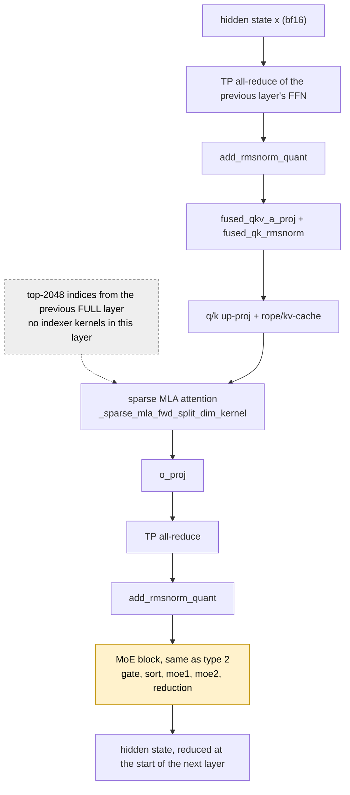

# GLM-5.2: the three decoder-layer types

Two independent config axes decide what a decoder layer runs:

| axis | config | effect |
|------|--------|--------|
| FFN | `first_k_dense_replace = 3` | layers 0-2 use a dense `DeepseekV2MLP`, layers 3-77 use `DeepseekV2MoE` |
| DSA indexer | `index_topk_freq = 4`, `index_skip_topk_offset = 3` | a **full** layer computes a fresh top-2048 selection, a **shared** layer reuses the previous full layer's and runs **no indexer kernels at all** |

`skips_topk(l) = max(l - 3 + 1, 0) % 4 != 0`, so full layers are **0, 1, 2, 6, 10, …, 74**
(21 of 78) — note the `max(…, 0)` clamp makes layers 0 *and* 1 full, not just layer 2.
Because all three dense layers are also full, only **three** combinations exist:

| # | layer type | layers | count |
|---|-----------|--------|-------|
| 1 | **full-indexer + MLP** | 0, 1, 2 | 3 |
| 2 | **full-indexer + MoE** | 6, 10, 14, …, 74 | 18 |
| 3 | **shared-indexer + MoE** | 3-5, 7-9, 11-13, …, 75-77 | 57 |

There is no "shared-indexer + MLP" layer.

## Type 1 — full-indexer + MLP (layers 0-2)

## Type 2 — full-indexer + MoE (layers 6, 10, …, 74)

Identical attention path; the dense MLP is replaced by the MoE block.

## Type 3 — shared-indexer + MoE (the other 57 layers)

No indexer kernels run: the top-2048 index list produced by the preceding full layer
is passed down and reused, so this layer only gathers with it.

## Measured cost per ONE layer (MI355X TP4, GLM-5.2-MXFP4, i8k conc64, SGLang)

µs for a single layer of each type, from `step3_layer_breakdown` (prefill = one
`step[EXTEND bs=3 toks=16368]`, decode = one `step[DECODE bs=64]`):

| layer type | layers | prefill | of which indexer | decode | of which indexer |
|---|---|---|---|---|---|
| full-indexer + MLP | 3 | 9373 (8456 on layer 0) | 1581 | 286 (272 on layer 0) | 95 |
| full-indexer + MoE | 18 | 10289 | 1581 | 426 | 95 |
| shared-indexer + MoE | 57 | 8708 (9569 on layer 77) | 0 | 330 (346 on layer 77) | 0 |

So the indexer costs 1.58 ms x 21 = **33 ms of a 711 ms prefill forward (4.7%)** and
95 µs x 21 = **2.0 ms of a 27.8 ms decode step (7.2%)** — budget it over 21 layers,
never over all 78.

## The two boundary layers, and why they are not a fourth type

Grouping layers by the kernels they run yields **five** raw groups, not three, because
the all-reduce between two layers is attributed to whichever layer the trace nests it
in. `analyze_trace.py` merges the five back into the three types (they share a type
name), so the workbook shows three:

| raw group | layers | type | why it split off |
|---|---|---|---|
| 0 | full-indexer + MLP | nothing reduces into layer 0 — its input is the embedding — so it has one all-reduce fewer, and its input RMSNorm is the no-residual-add variant (`…Lb0ELb0E…`, 60 µs) instead of the fused add+norm (`…Lb1ELb0E…`, 116 µs) |
| 1, 2 | full-indexer + MLP | the ordinary dense layers |
| 3-5, 7-9, …, 75, 76 (56) | shared-indexer + MoE | the most common layer |
| 6, 10, …, 74 (18) | full-indexer + MoE | runs the indexer chain |
| 77 | shared-indexer + MoE | its output all-reduce has no next layer to land in, so it appears inside layer 77's own MoE section |

Every layer still does the same **two** TP all-reduces — one summing the attention
`o_proj` output across ranks, one summing the FFN `down_proj` / MoE output — because
both are row-parallel and each rank only holds a partial sum. They are simply
distributed 77 (`prepare_attn`) + 78 (`prepare_mlp`) + 1 (inside layer 77) = 156 across
the annotations. A prefill forward measures 157; the odd one runs after the stack
(`lm_head` / logits). In the workbook these two layers show up only as rows with
`LaunchCount = 1`, which is why no fourth or fifth type is needed.
